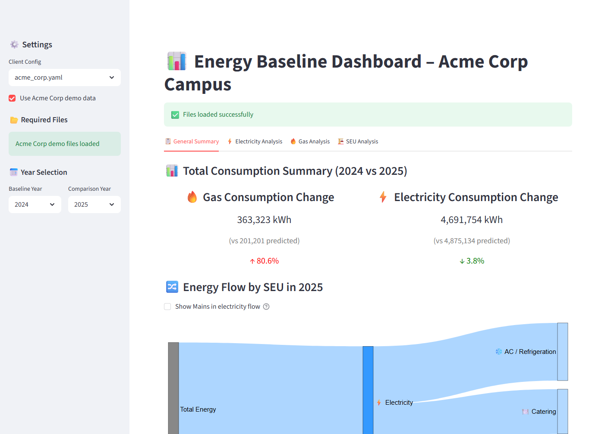
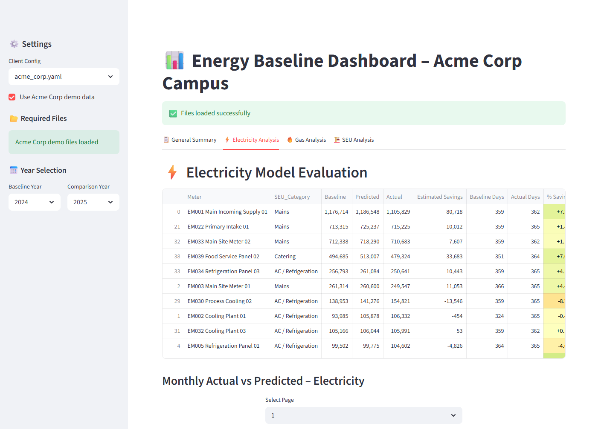
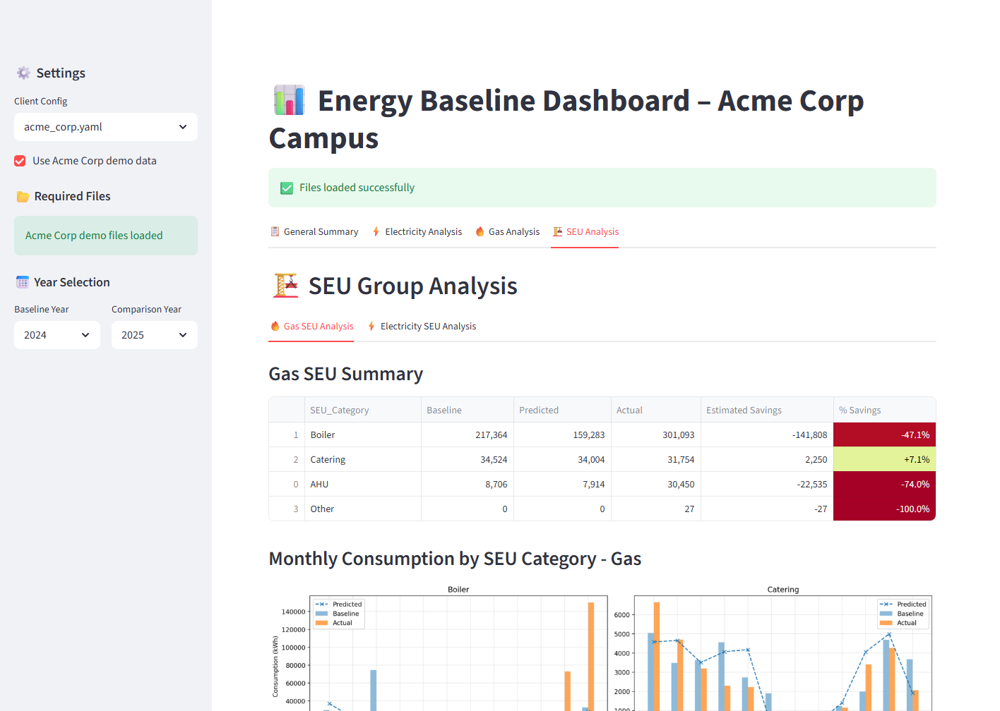

# From CSVs to ISO 50001 Energy Insight: An Acme Corp Dashboard Walkthrough

Energy performance reviews often start in the same messy place: meter exports, weather files, and a mapping spreadsheet that explains which meters belong to each Significant Energy Use category. The Acme Corp demo shows how this dashboard turns that input pack into a climate-normalized review that an energy manager can use for ISO 50001 conversations.

The showcase data has been anonymized. The time-series values, weather values, and SEU categories are retained so the workflow behaves like a real analysis, but the site, area, meter, and weather-station labels have been replaced with generic Acme Corp names.



## What the App Does

The Streamlit app starts in `app.py`. The sidebar selects a client configuration, accepts the four required inputs, and lets the user choose a baseline year and comparison year. For the showcase, `?demo=acme` loads the anonymized files from `sample_data/acme_corp` so the app can be opened without manually uploading private files.

The main analysis path runs through `utils.py`:

1. The energy export is cleaned and reshaped from a report-style meter block into daily gas and electricity records.
2. HDD and CDD files are parsed and merged onto the relevant daily records.
3. The uploaded SEU mapping is applied in memory, so meter categories stay scoped to the current run rather than being read from a shared local file.
4. Each meter is modelled against the appropriate driver: heating degree days, cooling degree days, operational days, or fixed baseline behavior.
5. The app compares actual consumption against climate-normalized predictions for the selected comparison year.

The result is a set of tabs for an energy review: general summary, electricity analysis, gas analysis, and SEU analysis.

## Reading the Summary

The general summary compares 2025 actual consumption against what the model predicted from the 2024 baseline. In the Acme Corp demo, electricity is slightly below the modelled expectation, while gas is above it. The Sankey view then turns that into an energy-flow story by commodity and SEU category, which is much easier to explain than a raw meter table.

## Meter-Level Modelling

The electricity tab ranks meters by actual consumption and shows baseline, predicted, actual, estimated savings, operating days, and percent savings. The app also paginates monthly actual-vs-predicted plots so large meter estates remain reviewable.



This is useful for finding the meters that deserve attention first. A user can scan the largest loads, spot categories with adverse variance, and then move into the monthly plots for seasonal or operational patterns.

## SEU-Level Evidence

The SEU tab aggregates the same modelling outputs into ISO 50001-friendly groups. Instead of asking reviewers to reason through dozens of meter names, the app summarizes gas and electricity performance by category and then shows monthly category plots.



That makes the output more suitable for management review: the discussion can stay focused on energy uses, variance, and action planning.

## How the Codebase Is Evolving

The repository has two layers. The current working dashboard is the Streamlit app, which preserves the mature analytics workflow. Alongside it, the repo already has SaaS scaffolding in `backend/` and `frontend/`: FastAPI domain models, tenant and RBAC concepts, upload/run/report metadata, audit events, and a Next.js dashboard shell.

That matters because the analytics are no longer trapped in the legacy UI. The reusable pieces in `src/` and `analytics/` are being moved toward a tenant-scoped platform where each organization can upload data, run analysis, keep history, and retrieve report artifacts without sharing local mutable files.

## Running the Showcase

Start the dashboard:

```powershell
python -m streamlit run app.py --server.headless true --server.port 8501 --client.toolbarMode minimal
```

Open the anonymized demo:

```text
http://localhost:8501/?demo=acme
```

The dashboard will select the Acme Corp config, load the anonymized source files, and render the baseline comparison automatically.
